<div align="center">

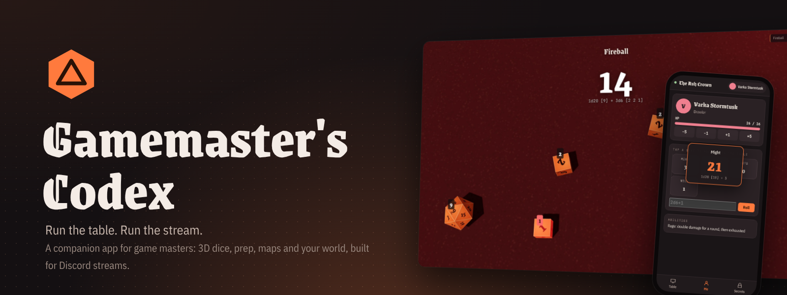

<br>

[](https://github.com/lostmaguss/gamemasters-codex/releases/latest)
[](https://github.com/lostmaguss/gamemasters-codex/releases)
[](https://github.com/lostmaguss/gamemasters-codex/releases/latest)
[](https://github.com/lostmaguss/gamemasters-codex/releases/latest)

### A desktop companion for game masters who play at the table *and* on Discord.
Prep the session, run it, stream it, remember it. Any system, including your own homebrew. Fantasy, sci-fi or cyberpunk.

<br>

<a href="https://github.com/lostmaguss/gamemasters-codex/releases/latest"></a>

<br><br>

<a href="docs/media/trailer.mp4">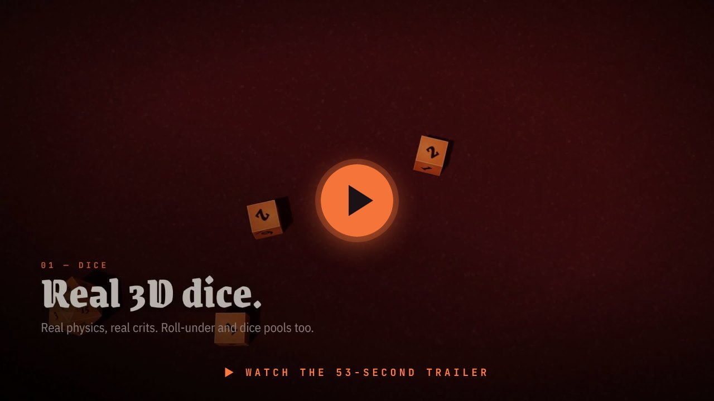</a>

</div>

<br>

## 🎲 Dice that actually roll


Real 3D dice with physics: they tumble, collide and land, and the result is read from the top face.

- **Every notation:** `2d20kh1`, `4d6dl1`, exploding `3d6!`, rerolls `4d6r1`, Fate `4dF`, dice pools `8d6>=5`, roll-under `1d100<=45`
- **Your crit rules:** natural 20s, natural 1s, or low-is-good systems
- **Custom dice:** put symbols, words or emoji on the faces (⚔ ✦ ☠), roll `3d[Boon]` and get a tally
- **Player colors:** each character's dice roll in their own color, with their name on the result
- **Secret rolls** stay on your screen; everything else lands on stream

<br clear="right">

## 📺 Built for streaming

Open the **stream window** and share it in Discord (or load the overlays in OBS). Your notes stay private. Players only see what you choose to show.

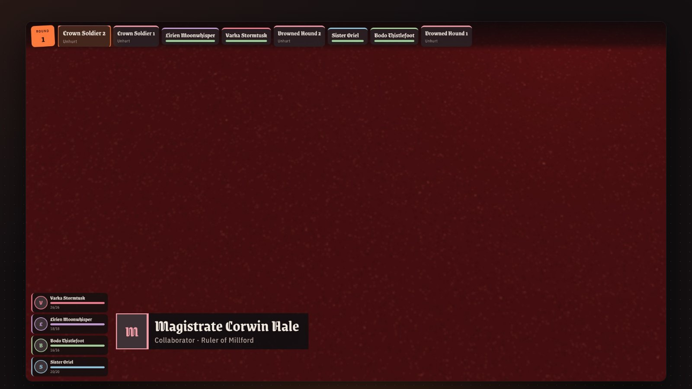

<table>
<tr>
<td width="50%" valign="top"><br><b>Party votes.</b> Ask the table a question; players vote with Discord buttons or their phones, and the bars fill in live.</td>
<td width="50%" valign="top">

**On stream, one click away:**
- 🎲 Dice with results and roll history
- ⚔️ Turn order and party health
- 🗺️ Battle maps with fog of war
- 📜 Handouts, letters and pictures
- 🏷️ TV-style name cards for NPCs
- 💎 Glowing loot reveals
- 🌧️ Weather: rain, snow, storms, neon glitch
- 🎬 Full-screen scenes: *Starting soon*, *Previously on…*, *Break*
- ⏱️ Countdowns and progress clocks
- 🔊 Soundboard, ambience and music

</td>
</tr>
</table>

## 📱 Players' phones

Turn on the **table link** and players scan a QR code. Each picks their character and gets their sheet, handouts, the map, turn order and votes on their phone. **Tapping a stat rolls the dice on your table**, and whispers land in their private *Secrets* tab. Works at the table on your Wi-Fi, or **from anywhere** over a secure Cloudflare link for your Discord players. No app to install.

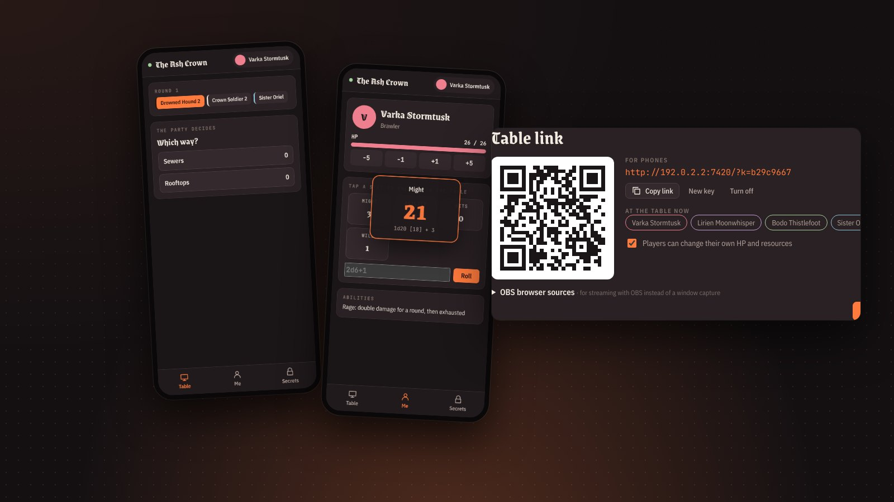

## 🧙 Everything a GM juggles

<table>
<tr>
<td width="50%" valign="top">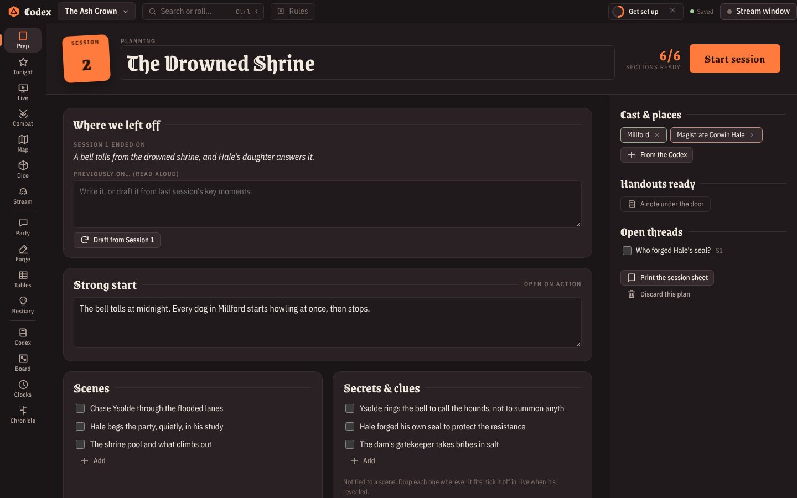<br><b>Prep.</b> Strong start, scenes, secrets & clues, cast, encounters with a <b>difficulty meter</b>, treasure. Print it as a one-page session sheet.</td>
<td width="50%" valign="top">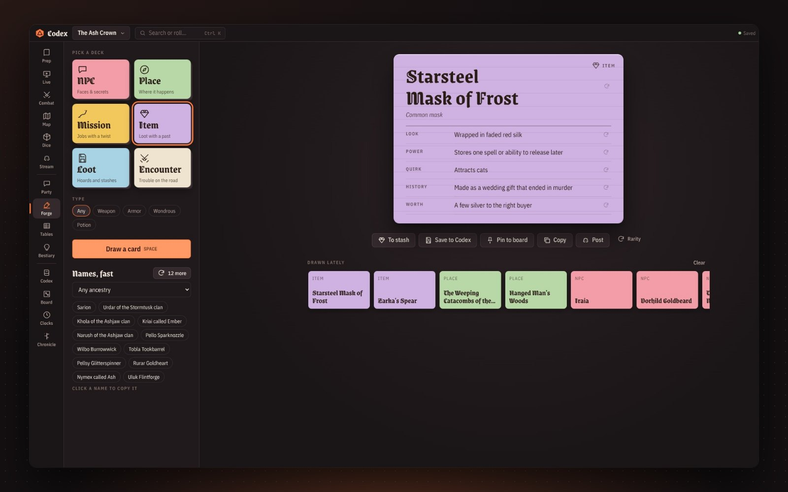<br><b>Forge.</b> Deal NPCs, places, missions, items, loot and encounters, with names in seconds. Genre-aware.</td>
</tr>
<tr>
<td valign="top">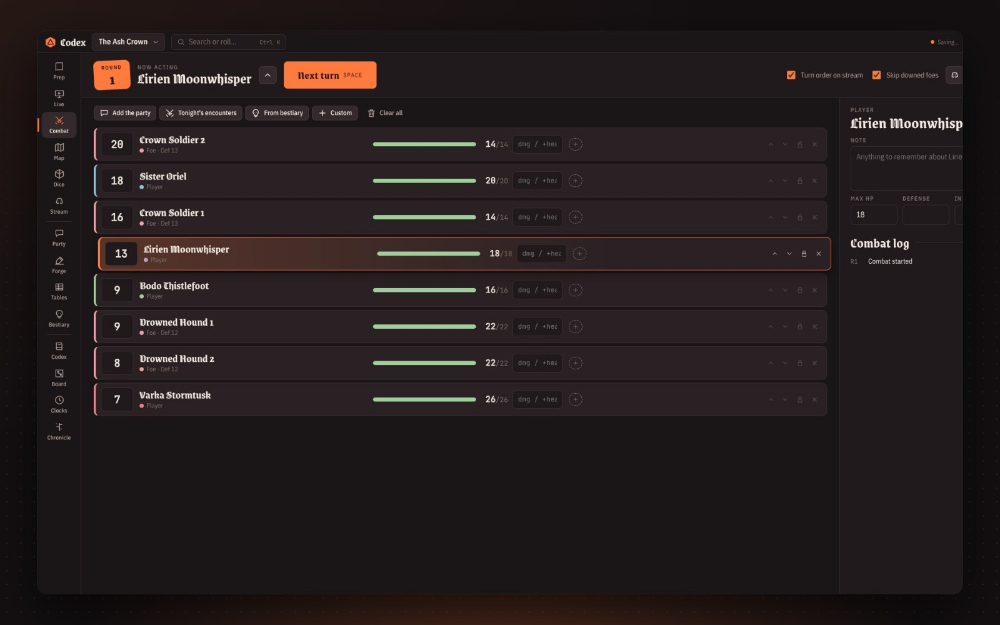<br><b>Combat.</b> Initiative, HP, conditions that count down, damage straight from rolls, and the turn order on stream.</td>
<td valign="top">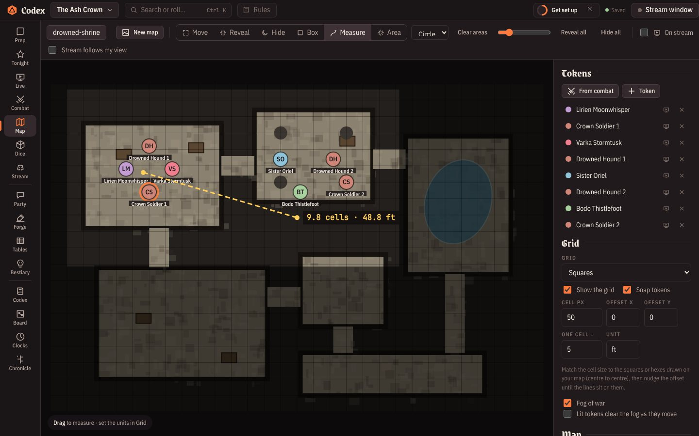<br><b>Battle maps.</b> Grid, tokens, fog you paint away, measuring and area templates.</td>
</tr>
<tr>
<td valign="top">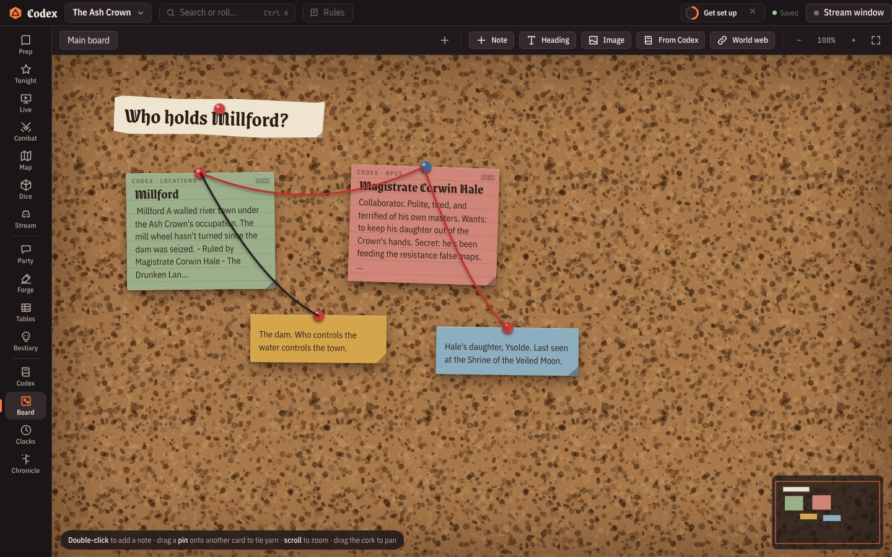<br><b>Corkboard.</b> Pin clues and suspects, tie red string. <i>World web</i> builds one from your notes.</td>
<td valign="top">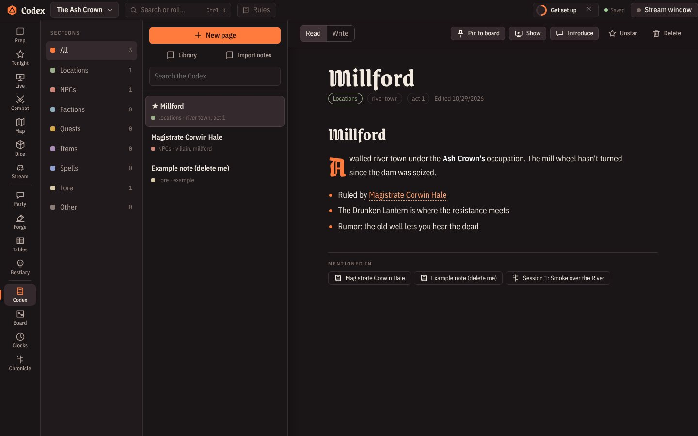<br><b>Codex.</b> A wiki of your world with <code>[[links]]</code>, backlinks, templates and pictures.</td>
</tr>
<tr>
<td valign="top">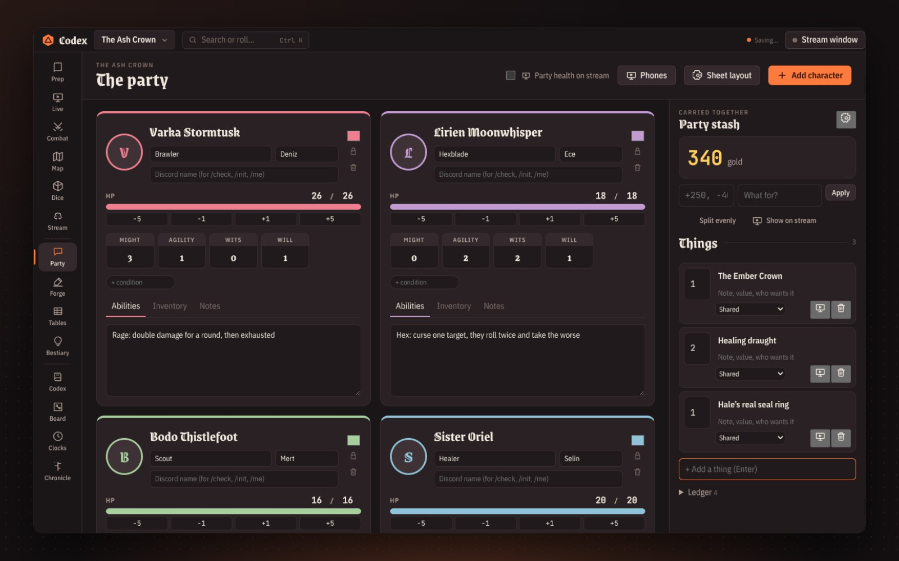<br><b>Party.</b> Character sheets shaped like <i>your</i> system, one-click stat rolls, and a shared stash for money and loot.</td>
<td valign="top">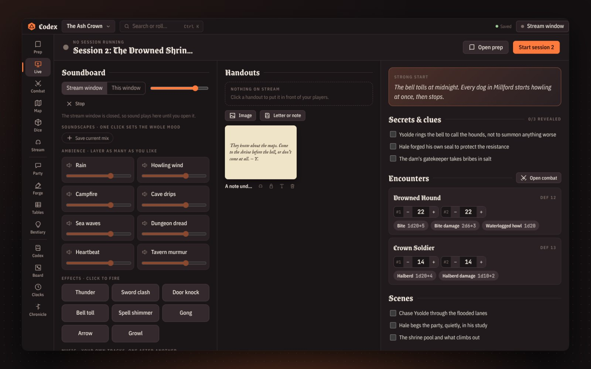<br><b>Live.</b> Soundboard, soundscapes, handouts, tonight's secrets, monster HP and an improv kit for when players go off-script.</td>
</tr>
<tr>
<td valign="top">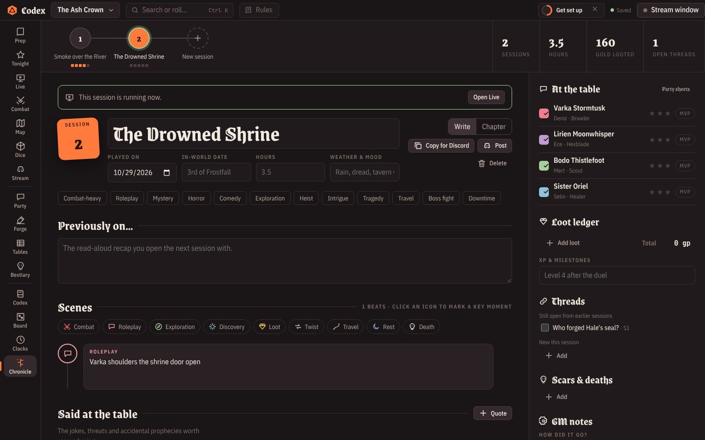<br><b>Chronicle.</b> Every session as a chapter: scenes, quotes, loot, spotlight stars, threads. Posts a recap card with pictures to Discord.</td>
<td valign="top">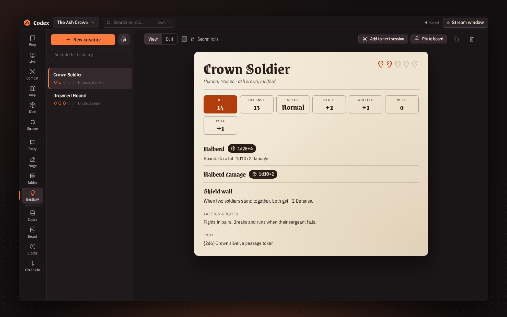<br><b>Bestiary.</b> Creatures with your own stat layout; abilities become one-click rolls.</td>
</tr>
</table>

Also inside: random tables that roll other tables · world clocks, calendar and faction reputation · `Ctrl+K` to find anything · printable NPC cards, handouts and character sheets · daily backups · auto-updates.

## 🌌 Fantasy, sci-fi or cyberpunk

Pick a genre and the whole app follows: generators, starter tables, sounds, dice and the look of the interface.

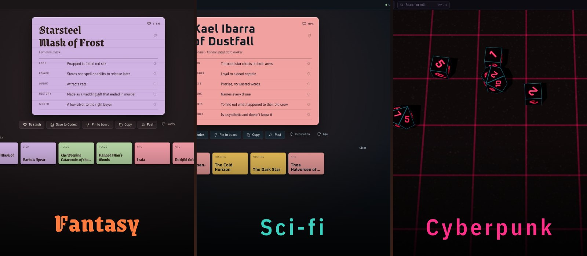

## 🤖 Discord, all the way

| | |
|---|---|
| **Webhook posts** | Rolls, handouts, turn order and session recaps (with pictures) go to your channel |
| **Dice bot** | Players type `/roll`, `/check Agility`, `/init`, `/me`, `/stash`. Their dice land on your stream |
| **Whispers** | Secrets as private messages, to Discord or to the player's phone |
| **Votes** | Buttons under a question in your game channel |

<br>

## ⬇️ Get started

1. **[Download the installer](https://github.com/lostmaguss/gamemasters-codex/releases/latest)** (`GamemastersCodex-Setup-x.y.z.exe`) and run it.
   Windows may warn that the app isn't signed: click *More info → Run anyway*. After that the app updates itself.
2. The sample campaign **The Ash Crown** shows how everything fits together. Make your own from the campaign menu (top left).
3. Press **F1** any time for every keyboard shortcut.

<details>
<summary><b>📺 Streaming on Discord, step by step</b></summary>

1. Click **Stream window** in the top bar. A second window opens with just the table.
2. In Discord: *Share Screen → Applications → Codex Dice (stream)*. Turn on **Sound** if you use the soundboard.
3. Keep working in the main window. Everything you choose to show goes to the stream window. Secret rolls never do.

In the stream window: **H** hides the roll history, **F** goes fullscreen, and the control bar fades out on its own.
For an in-person table, **Player display on a second screen** puts it fullscreen on a TV or projector.
</details>

<details>
<summary><b>🎥 OBS browser sources</b></summary>

Campaign menu → **Table link: phones & OBS** → *OBS browser sources*. Copy a link, add it in OBS as a **Browser** source at 1920 × 1080. The background is see-through. There are links for everything, dice only, turn order, party bar, map, popups and scenes. While an OBS dice source is open, rolls happen there, and you don't need the stream window.
</details>

<details>
<summary><b>📱 Setting up players' phones</b></summary>

Campaign menu → **Table link: phones & OBS** → turn it on, then pick:

- **Same Wi-Fi:** for an in-person table. Phones must be on the same network as your computer. The first time, Windows asks to let the app on your network: allow **Private networks**.
- **Anywhere (internet):** for players at home. One click makes a secure `https://…trycloudflare.com` link through Cloudflare (free, no account). The first time, the app downloads Cloudflare's tunnel helper (about 55 MB). The address changes each time you turn it on.

Only people with the link can open it, and wrong guesses are slowed down. *New key* makes old links stop working. You choose whether players can change their own HP.
</details>

<details>
<summary><b>🔗 Posting to a Discord channel (webhook)</b></summary>

*Campaign menu → Connect Discord*. In Discord: *channel settings → Integrations → Webhooks → New Webhook → Copy Webhook URL*, then paste it. Post rolls, handouts, turn order and session recaps automatically or with the Post buttons.
</details>

<details>
<summary><b>🤖 Player dice bot</b></summary>

1. [discord.com/developers/applications](https://discord.com/developers/applications) → **New Application**.
2. **Bot → Reset Token**, copy it, and paste it in *Campaign menu → Discord → Player dice bot*. Press **Connect**.
3. Open the invite link the app shows and add the bot to your server.
4. Put each player's Discord name on their party sheet.

| Command | Does |
|---|---|
| `/roll 1d20+5 Stealth` (or `/r`) | Any roll, any notation |
| `/check Agility` | Rolls that player's stat with your sheet's formula |
| `/init` | Rolls their initiative straight into your combat tracker |
| `/me` | Shows them their own sheet, privately |
| `/stash` | Shows the party's money and loot |

The bot only answers while the app is open.
</details>

<details>
<summary><b>🎲 Dice notation</b></summary>

| Write | Means |
|---|---|
| `2d6+3`, `d20`, `d%` | The usual |
| `2d20kh1`, `4d6dl1` | Keep highest 1, drop lowest 1 |
| `3d6!` | Exploding: a max rolls again |
| `4d6r1` | Reroll 1s once |
| `3d[Boon]` | Custom dice with your own faces (make them in the Dice view) |
| `4dF` | Fate/Fudge dice |
| `1d100<=45` | Roll-under target: Success or Failure |
| `8d6>=5` | Dice pool: count the hits |

Which die makes a critical, whether high or low is good, and initiative order are set in *Campaign menu → Rules & genre*.
</details>

<details>
<summary><b>⌨️ Keyboard</b></summary>

`Ctrl+K` search & commands · `Ctrl+L` log a moment · `Ctrl+1…0` sections · `Ctrl +/−` interface size · `Space` next turn in combat · `F1` all shortcuts
</details>

<details>
<summary><b>💾 Your data</b></summary>

Everything stays on your computer in `%APPDATA%\Gamemasters Codex\`. A dated backup is kept every day for 14 days (*Campaign menu → Restore a backup*). *Export backup* writes one file with all pictures included, so it works on any computer.
</details>

<details>
<summary><b>🛠️ Develop</b></summary>

```
npm install
npm start               # run the app
npm run dist            # build the Windows installer (Wine needed on Linux)
```

Electron · three.js + cannon-es for the dice · discord.js for the bot. Pushing a new `version` in `package.json` to `main` builds, checks and publishes a release automatically (GitHub Actions).
</details>

<br>

<div align="center">
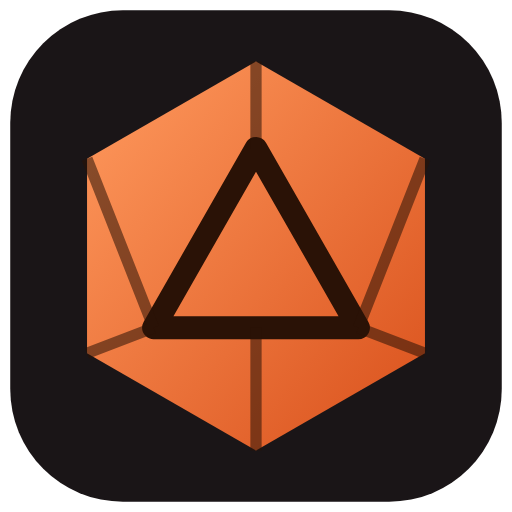<br>
<sub>Made for the GMs who keep the world in their heads. Roll well.</sub>
</div>
