<div align="center">


<br>

[](https://github.com/lostmaguss/gamemasters-codex/releases/latest)
[](https://github.com/lostmaguss/gamemasters-codex/releases)
[](https://github.com/lostmaguss/gamemasters-codex/releases/latest)
[](https://github.com/lostmaguss/gamemasters-codex/releases/latest)

### A desktop companion for game masters who play at the table *and* on Discord.
Prep the session, run it, stream it, remember it. Any system, including your own homebrew. Fantasy, sci-fi or cyberpunk.

<br>

<a href="https://github.com/lostmaguss/gamemasters-codex/releases/latest"></a>

<br><br>

<a href="docs/media/trailer.mp4"></a>

</div>

<br>

## Dice that actually roll


Real 3D dice with physics: they tumble, collide and land, and the result is read from the top face.

- **Every notation:** `2d20kh1`, `4d6dl1`, exploding `3d6!`, rerolls `4d6r1`, Fate `4dF`, dice pools `8d6>=5`, roll-under `1d100<=45`
- **Your crit rules:** natural 20s, natural 1s, or low-is-good systems
- **Fate dice** with bold + and − faces that read from any angle, and results off the ladder (+2 Fair, +3 Good)
- **Custom dice:** put symbols or words on the faces, roll `3d[Boon]` and get a tally
- **Player colors:** each character's dice roll in their own color, with their name on the result
- **Secret rolls** stay on your screen; everything else lands on stream

<br clear="right">

## Game night on one screen

**Tonight** puts what you need while you play in three columns: the turn order with a big *Next turn* button (or Space), tonight's strong start, scenes and secrets to tick off, a log line, and the party's health with quick rolls. A clock shows how long you've played, *Break* puts the break screen on stream, and focus mode hides the sidebar.

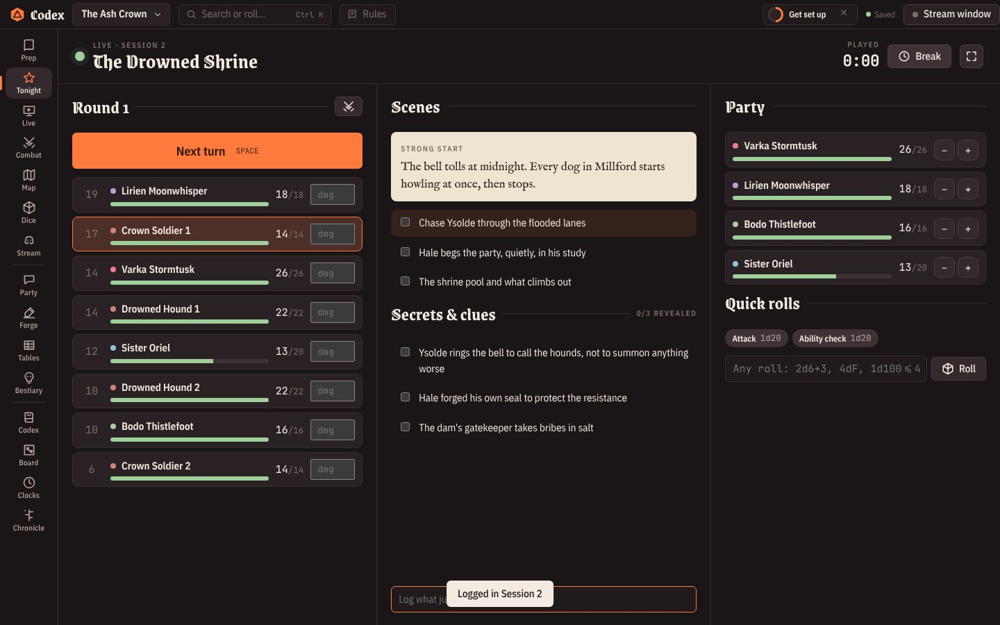

### Run it from your phone

The **GM remote** is your own secret link (not the players' one). Scan its QR code and your phone can advance turns, apply damage, nudge party HP, roll (in secret if you like), tick off scenes and secrets, log what happened, show and hide handouts and put up the break screen. *Settings → Connections → GM remote.*

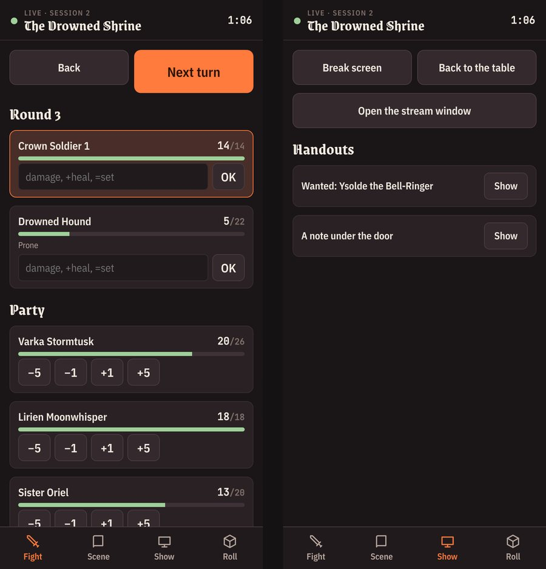

## Any system, with its monsters and rules

Pick your game when you create a campaign and the Codex sets up the dice rules, the party sheet, the bestiary's stat block, quick rolls and the genre (generators, sounds, look). Change systems later in *Settings → Game & rules*, or just borrow a sheet in *Party → Sheet layout → Start from a system*. Everything stays editable.

Each system also has a **Library**: ready-made creatures for the Bestiary (with clickable attack and damage rolls) and spells, powers or gear for the Codex, about 300 entries in all. Tick *Fill from the library* when you create the campaign, or open it later from the book button in the Bestiary and the Codex. Write `` `8d6` `` in any Codex page and it becomes a roll button.

Where the entries come from:

| System | Source |
|---|---|
| D&D 5e | System Reference Document 5.1, Wizards of the Coast, [CC-BY-4.0](https://creativecommons.org/licenses/by/4.0/). Checked against the SRD |
| Pathfinder 2e | Paizo's Monster Core (ORC) and Bestiary (OGL), Player Core spells, from the open Pathfinder data. Checked against it |
| Pathfinder 1e | Core Rulebook and Bestiary, Open Game Content (OGL). Spells checked against the open rules, monsters rebuilt from their Hit Dice, armor and attacks |
| Daggerheart | Daggerheart SRD 1.0, © Critical Role, LLC, under the Darrington Press Community Gaming License (DPCGL). Taken from the SRD |
| Fate Core, Fate Accelerated | Fate SRDs, Evil Hat Productions, CC-BY 3.0. Stunts, NPC tiers and rules from the SRD; named NPCs are examples |
| Blades in the Dark | Blades SRD, John Harper / One Seven Design, CC-BY 3.0. Abilities and rolls from the SRD; Blades has no monster stats, so threats are examples |
| Everything else | Written for the Codex in the style of the game, not taken from its books. Check numbers against your copy |

D&D 5e · Pathfinder 2e · Pathfinder 1e / 3.5 · OSR (B/X, OSE, Knave) · Daggerheart · Call of Cthulhu 7e · Powered by the Apocalypse · Blades in the Dark · Vampire V5 · Savage Worlds · Fate Core · Fate Accelerated · Cyberpunk RED · Shadowrun 6e · Mothership · Traveller · Space opera d6 · Homebrew d20

<table>
<tr>
<td width="50%" valign="top">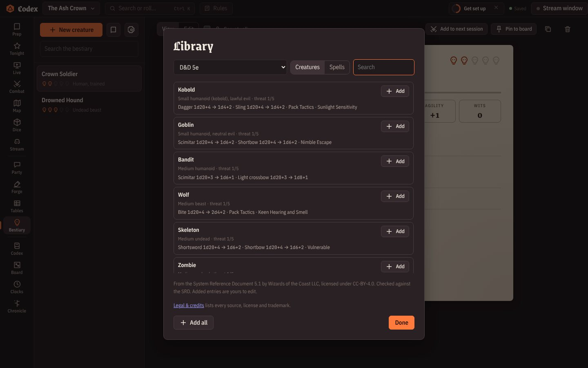<br><b>Library.</b> Creatures go to the Bestiary with their attacks as roll buttons; spells and powers go to the Codex.</td>
<td width="50%" valign="top">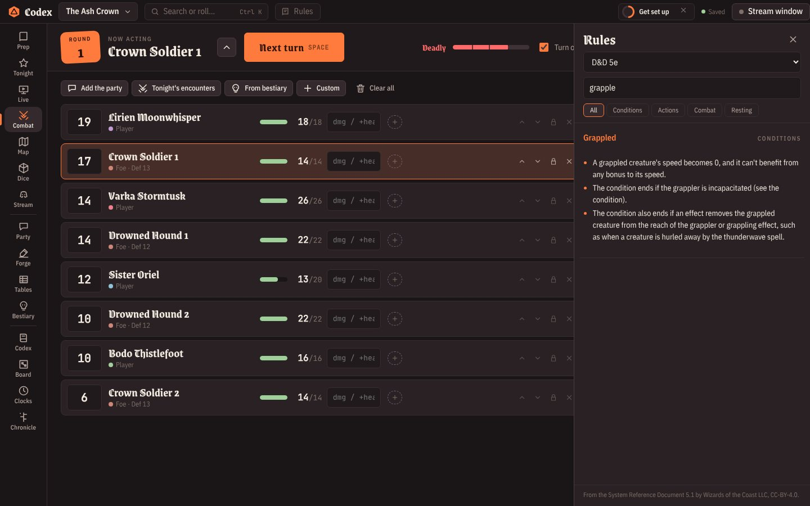<br><b>Rules reference (F2).</b> Conditions and core rules for your system in a side panel, searchable. Text comes from the open SRDs for D&D 5e, Daggerheart and Fate, and short summaries for the rest. The combat tracker offers your system's conditions and shows their rules on hover.</td>
</tr>
</table>

## Ready-to-play adventures

Pick **D&D 5e**, **Pathfinder 2e**, **Daggerheart**, **Call of Cthulhu** or **Cyberpunk RED** in *New campaign* and tick *Start with a ready-to-play adventure*. You get a whole campaign you can run tonight: pregenerated characters on the party sheets, Codex pages for every place, NPC, faction and clue, a bestiary with stat blocks, a clue board, threat clocks, handouts, a played prologue in the Chronicle with its read-aloud recap, and the next sessions planned in Prep with strong starts, scenes, secrets, encounters and treasure.

- **The Barrow of Thornbury** (D&D 5e, levels 1 to 3, four sessions). Goblins raid a harvest village, a barrow under Gallows Hill holds a sleeping dead king, and a green hag in the bog wants his crown. Monsters and magic items from the SRD 5.1.
- **The Silence at Ashby Falls** (Call of Cthulhu, 1925, three sessions). A reporter is missing, the church bell won't ring, and the mill's night shift keeps getting smaller. Four investigators, a cult, and ghouls beneath the falls.
- **The Lantern Road** (Pathfinder 2e, levels 1 to 3, four sessions). Guard a caravan on a moor road whose lantern-shrines are going dark: paid-off goblins, a haunted waystation, a troll under the Weeping Bridge. Creatures from Monster Core.
- **The Hungry Root** (Daggerheart, level 1, four sessions). Bandits raid an orchard village, the Great Tree weeps black sap, and a demon bound in its roots is waking. Adversaries, classes and domain cards from the SRD, a Fear tracker and a countdown.
- **Dead Air** (Cyberpunk RED, a starting crew, three sessions). Pull a braindance editor out of a gang-held tower before a corp kill team does, then decide what to do with the recording everyone wants.

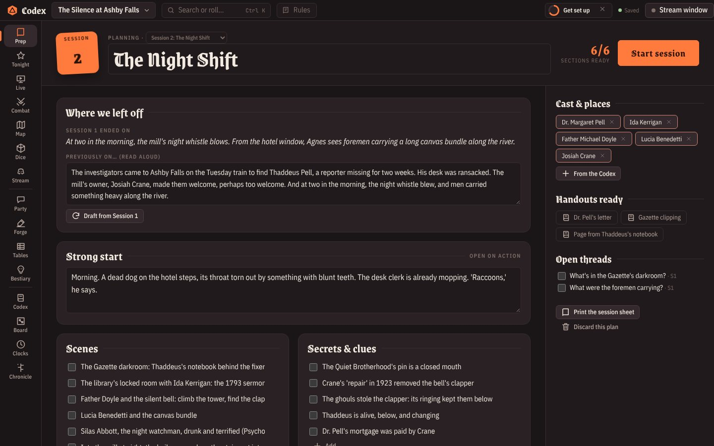

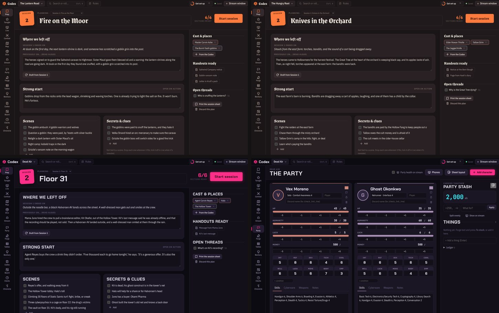

Each of the five systems also gets its own **random tables** (traps, encounters by level, pocket treasure, magic items, crits and fumbles for D&D; strange occurrences, library research, 1920s headlines, phobias, manias, Mythos tomes and temporary insanity for Cthulhu; hazards with DCs and Hero Point moments for Pathfinder; Fear moves, countdowns and campfire questions for Daggerheart; gig complications, netrun hazards and cyberware glitches for Cyberpunk RED) and its own **Forge**: D&D deals dragonborn and tieflings, SRD magic items with their real rules and rarity, and rewards in gp; Cthulhu deals 1920s names, occupations, speakeasies, churches and asylums, Mythos tomes and dollars; Pathfinder deals goblins, item levels and runes; Daggerheart deals katari, ribbets and galapa and pays in handfuls and bags of gold; Cyberpunk RED pays in eb. Existing campaigns can add the tables with `Ctrl+K` → *Add this game system's random tables*.

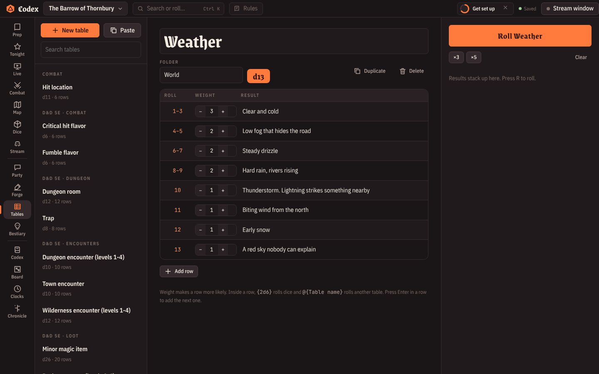

## Built for streaming

Open the **stream window** and share it in Discord (or load the overlays in OBS). Your notes stay private. Players only see what you choose to show.


<table>
<tr>
<td width="50%" valign="top"><br><b>Party votes.</b> Ask the table a question; players vote with Discord buttons or their phones, and the bars fill in live.</td>
<td width="50%" valign="top">

**On stream, one click away:**
- Dice with results and roll history
- Turn order and party health
- Battle maps with fog of war
- Handouts, letters and pictures
- TV-style name cards for NPCs
- Glowing loot reveals
- Weather: rain, snow, storms, neon glitch
- Full-screen scenes: *Starting soon*, *Previously on…*, *Break*
- Countdowns and progress clocks
- Soundboard, ambience and music

</td>
</tr>
</table>

## Players' phones

Turn on the **table link** and players scan a QR code. Each picks their character and gets their sheet, handouts, the map, turn order and votes on their phone. **Tapping a stat rolls the dice on your table**, and whispers land in their private *Secrets* tab. Works at the table on your Wi-Fi, or **from anywhere** over a secure Cloudflare link for your Discord players. No app to install.


## Everything a GM juggles

<table>
<tr>
<td width="50%" valign="top"><br><b>Prep.</b> Strong start, scenes, secrets & clues, cast, encounters with a <b>difficulty meter</b>, treasure. Print it as a one-page session sheet.</td>
<td width="50%" valign="top"><br><b>Forge.</b> Deal NPCs, places, missions, items, loot and encounters, with names in seconds. Genre-aware.</td>
</tr>
<tr>
<td valign="top"><br><b>Combat.</b> Initiative, HP, your system's conditions that count down, damage straight from rolls, and the turn order on stream.</td>
<td valign="top"><br><b>Battle maps.</b> Grid, tokens, fog you paint or box away, measuring and area templates.</td>
</tr>
<tr>
<td valign="top"><br><b>Corkboard.</b> Pin clues and suspects, tie red string. <i>World web</i> builds one from your notes.</td>
<td valign="top"><br><b>Codex.</b> A wiki of your world with <code>[[links]]</code>, backlinks, templates and pictures. Write <code>`2d6`</code> and it becomes a roll button.</td>
</tr>
<tr>
<td valign="top"><br><b>Party.</b> Character sheets shaped like <i>your</i> system, one-click stat rolls, and a shared stash for money and loot.</td>
<td valign="top"><br><b>Live.</b> Soundboard, soundscapes, handouts, tonight's secrets, monster HP and an improv kit for when players go off-script.</td>
</tr>
<tr>
<td valign="top"><br><b>Chronicle.</b> Every session as a chapter: scenes, quotes, loot, spotlight stars, threads. Posts a recap card with pictures to Discord.</td>
<td valign="top"><br><b>Bestiary.</b> Creatures with your own stat layout; abilities become one-click rolls.</td>
</tr>
</table>

Also inside: import your Obsidian vault or Markdown notes · players' private journals · random tables that roll other tables · world clocks, calendar and faction reputation · `Ctrl+K` to find anything · printable NPC cards, handouts and character sheets · daily backups · auto-updates.

### Hex maps and light

Pick squares, pointy-top hexes or flat-top hexes to match the map you load. Snapping is its own switch, the ruler counts hexes, and a token can carry light: with *Lit tokens clear the fog* on, moving it reveals the map around it, so the party explores as they walk.

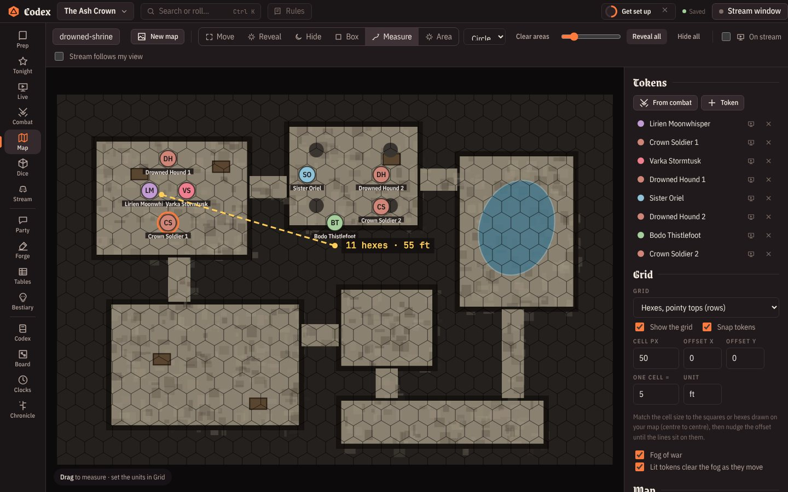

### Handout maker

Make the handout instead of hunting for one: a letter sealed in wax, a wanted poster, a newspaper front page, a royal decree, a sci-fi data pad or a cyberpunk chat log. Fill in the words (and a portrait if you like), and it's saved as a picture you can show on stream, send to phones or post to Discord. *Live → Handouts → Make one.*

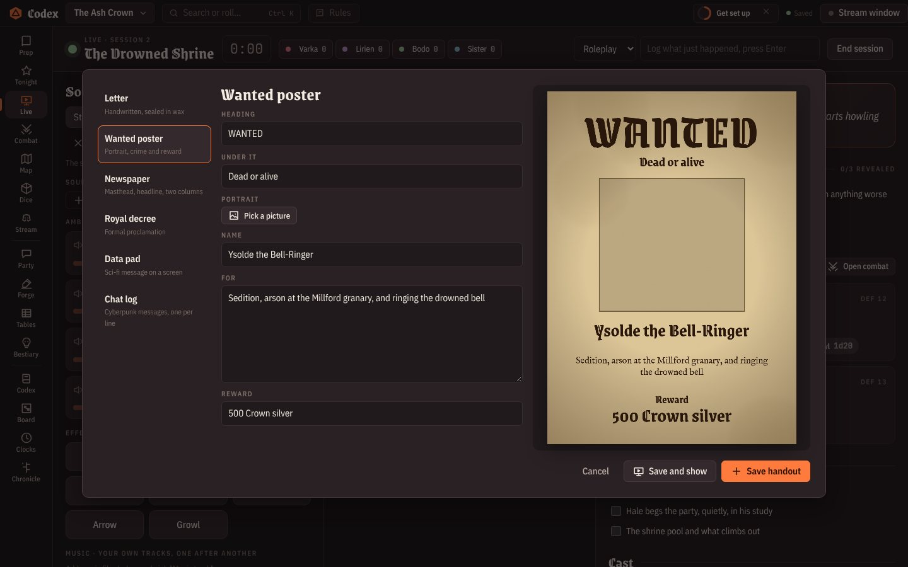

### Drag and drop

Drag a creature from the Bestiary into Combat, Tonight or onto the Map (hover over a sidebar section to switch to it on the way). Drop pictures straight onto Codex pages, creatures, character portraits and handouts. Drop a `.codexpack` file anywhere on the window to open it.

## Make it yours

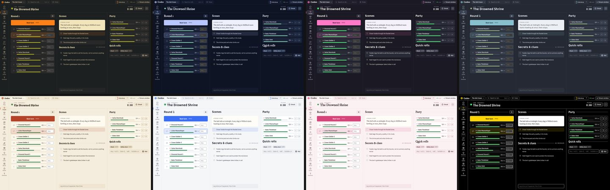

**15 themes**, dark and light: Lantern, Neon, Void, Tavern, Grove, Moonlit, Frost, Nightshade, Rosewood, Abyss (true black for OLED), Parchment, Daylight, Solar, Sakura and High contrast. Each campaign can have its own, or *Match the genre* picks one for you.

<table>
<tr>
<td width="50%" valign="top">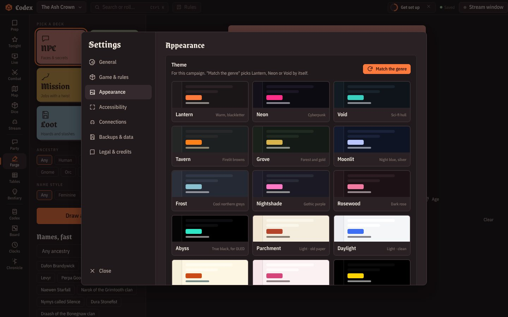<br><b>One Settings window (Ctrl+,).</b> General, game & rules, appearance, accessibility, connections, backups & data, legal & credits.</td>
<td width="50%" valign="top">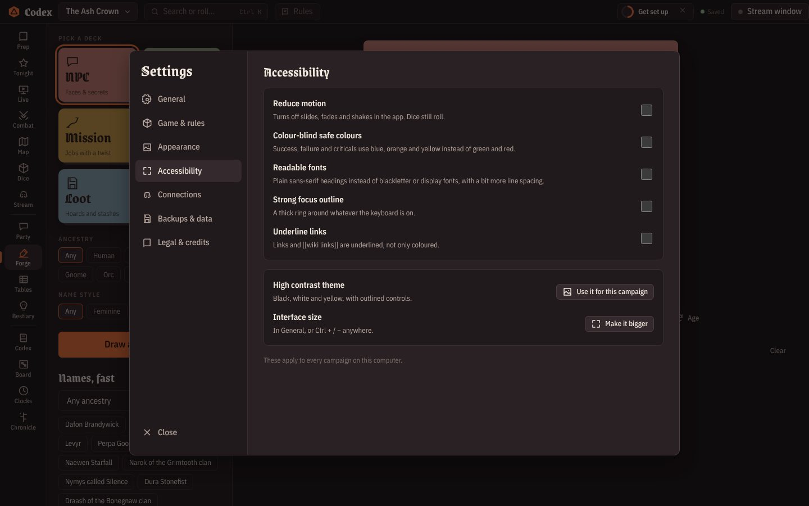<br><b>Accessibility.</b> Reduce motion, colour-blind safe colours (blue, orange and yellow instead of green and red), readable fonts, a strong focus outline, underlined links, interface size.</td>
</tr>
<tr>
<td valign="top">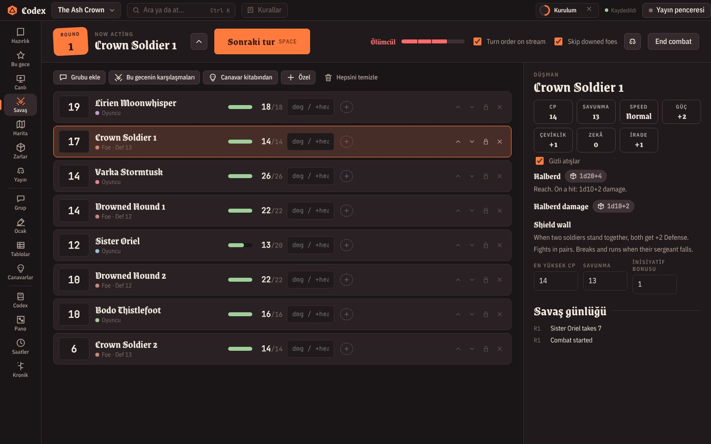<br><b>Türkçe.</b> The GM interface can be in Turkish (<i>Settings → General</i>), and so can everything players see (phones, the stream window, Discord) with <i>Players' language</i>. Your own notes and names are never touched.</td>
<td valign="top">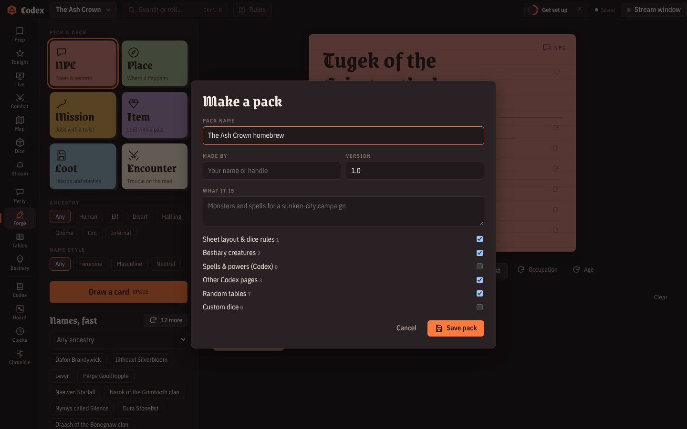<br><b>Homebrew packs.</b> Share your sheet layout and dice rules, monsters, spells, tables, custom dice and Codex pages as one <code>.codexpack</code> file with the pictures inside. Opening one shows what's in it and adds only what you don't already have.</td>
</tr>
</table>

## Safety nets

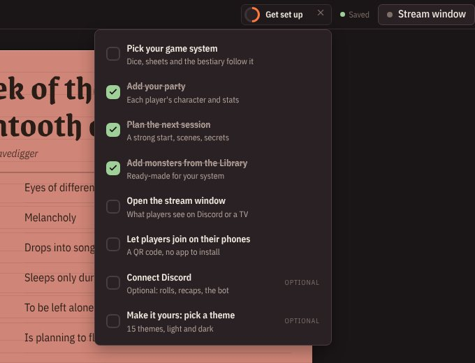

- **Undo everything.** `Ctrl+Z` and `Ctrl+Shift+Z` outside text boxes, and an *Undo* button on the message after every delete. Deleting a whole campaign can be undone until you close the app.
- **Setup checklist.** A new campaign shows a small ring in the title bar: pick a system, add the party, plan a session, add monsters, open the stream window, let players join. It ticks itself off as you go and gets out of the way when you're done.
- **Daily backups** for 14 days, and an export that carries every picture.
- **Private by design.** No accounts, no tracking, no analytics. See the [privacy policy](PRIVACY.md) for exactly what leaves your computer and when.

<br clear="right">

## Fantasy, sci-fi or cyberpunk

Pick a genre and the whole app follows: generators, starter tables, sounds, dice and the look of the interface.


## Discord, all the way

| | |
|---|---|
| **Webhook posts** | Rolls, handouts, turn order and session recaps (with pictures) go to your channel |
| **Dice bot** | Players type `/roll`, `/check Agility`, `/init`, `/me`, `/stash`. Their dice land on your stream |
| **Whispers** | Secrets as private messages, to Discord or to the player's phone |
| **Votes** | Buttons under a question in your game channel |

<br>

## Get started

1. **[Download](https://github.com/lostmaguss/gamemasters-codex/releases/latest)** the file for your computer:

   | | File | First launch |
   |---|---|---|
   | **Windows** 10 / 11 | `GamemastersCodex-Setup-x.y.z.exe` | If Windows warns that the app isn't signed: *More info → Run anyway*. |
   | **macOS**, Apple Silicon (M1 and newer) | `GamemastersCodex-x.y.z-arm64.dmg` | Drag it to Applications. The first time, macOS blocks it: open *System Settings → Privacy & Security* and click **Open Anyway**. |
   | **macOS**, Intel | `GamemastersCodex-x.y.z-x64.dmg` | Same as above. |
   | **Ubuntu / Debian** | `GamemastersCodex-x.y.z-amd64.deb` | `sudo apt install ./GamemastersCodex-*.deb`, then find it in your apps. |
   | **Any Linux** | `GamemastersCodex-x.y.z-x86_64.AppImage` | Make it executable (`chmod +x`) and run it. |

   Windows and Linux update themselves. On macOS the app tells you when there's a new version to download (automatic installs need a paid Apple certificate).
2. The sample campaign **The Ash Crown** shows how everything fits together. Make your own from the campaign menu (top left).
3. Press **F1** any time for every keyboard shortcut.

<details>
<summary><b>Streaming on Discord, step by step</b></summary>

1. Click **Stream window** in the top bar. A second window opens with just the table.
2. In Discord: *Share Screen → Applications → Codex Dice (stream)*. Turn on **Sound** if you use the soundboard.
3. Keep working in the main window. Everything you choose to show goes to the stream window. Secret rolls never do.

On Linux, Discord can't share an app window's sound; play the soundboard through your speakers or share your whole screen.

In the stream window: **H** hides the roll history, **F** goes fullscreen, and the control bar fades out on its own.
For an in-person table, **Player display on a second screen** puts it fullscreen on a TV or projector.
</details>

<details>
<summary><b>OBS browser sources</b></summary>

Campaign menu → **Table link: phones & OBS** → *OBS browser sources*. Copy a link, add it in OBS as a **Browser** source at 1920 × 1080. The background is see-through. There are links for everything, dice only, turn order, party bar, map, popups and scenes. While an OBS dice source is open, rolls happen there, and you don't need the stream window.
</details>

<details>
<summary><b>Setting up players' phones</b></summary>

Campaign menu → **Table link: phones & OBS** → turn it on, then pick:

- **Same Wi-Fi:** for an in-person table. Phones must be on the same network as your computer. The first time, Windows asks to let the app on your network: allow **Private networks**.
- **Anywhere (internet):** for players at home. One click makes a secure `https://…trycloudflare.com` link through Cloudflare (free, no account). The first time, the app downloads Cloudflare's tunnel helper (about 55 MB). The address changes each time you turn it on.

Only people with the link can open it, and wrong guesses are slowed down. *New key* makes old links stop working. You choose whether players can change their own HP.
</details>

<details>
<summary><b>Posting to a Discord channel (webhook)</b></summary>

*Settings → Connections → Discord*. In Discord: *channel settings → Integrations → Webhooks → New Webhook → Copy Webhook URL*, then paste it. Post rolls, handouts, turn order and session recaps automatically or with the Post buttons.
</details>

<details>
<summary><b>Player dice bot</b></summary>

1. [discord.com/developers/applications](https://discord.com/developers/applications) → **New Application**.
2. **Bot → Reset Token**, copy it, and paste it in *Campaign menu → Discord → Player dice bot*. Press **Connect**.
3. Open the invite link the app shows and add the bot to your server.
4. Put each player's Discord name on their party sheet.

| Command | Does |
|---|---|
| `/roll 1d20+5 Stealth` (or `/r`) | Any roll, any notation |
| `/check Agility` | Rolls that player's stat with your sheet's formula |
| `/init` | Rolls their initiative straight into your combat tracker |
| `/me` | Shows them their own sheet, privately |
| `/stash` | Shows the party's money and loot |

The bot only answers while the app is open.
</details>

<details>
<summary><b>Dice notation</b></summary>

| Write | Means |
|---|---|
| `2d6+3`, `d20`, `d%` | The usual |
| `2d20kh1`, `4d6dl1` | Keep highest 1, drop lowest 1 |
| `3d6!` | Exploding: a max rolls again |
| `4d6r1` | Reroll 1s once |
| `3d[Boon]` | Custom dice with your own faces (make them in the Dice view) |
| `4dF`, `4dF+3` | Fate/Fudge dice, read off the ladder (+3 Good). There's a dF button, and *Party → Sheet layout* has Fate Core and Fate Accelerated presets |
| `1d100<=45` | Roll-under target: Success or Failure |
| `8d6>=5` | Dice pool: count the hits |

Which die makes a critical, whether high or low is good, and initiative order are set in *Settings → Game & rules*.
</details>

<details>
<summary><b>Keyboard</b></summary>

`Ctrl+K` search & commands · `Ctrl+,` settings · `Ctrl+Z` undo · `F2` rules reference · `Ctrl+L` log a moment · `Ctrl+1…0` sections · `Ctrl +/−` interface size · `Space` next turn · `F1` all shortcuts
</details>

<details>
<summary><b>Your data</b></summary>

Everything stays on your computer: `%APPDATA%\Gamemasters Codex\` on Windows, `~/Library/Application Support/Gamemasters Codex/` on macOS, `~/.config/Gamemasters Codex/` on Linux. A dated backup is kept every day for 14 days (*Settings → Backups & data*). *Export backup* writes one file with all pictures included, so it works on any computer.
</details>

<details>
<summary><b>Develop</b></summary>

```
npm install
npm start               # run the app
npm run dist            # Windows installer (Wine needed on Linux)
npm run dist:linux      # AppImage + .deb
npm run dist:mac        # .dmg + .zip (on a Mac)
```

Electron · three.js + cannon-es for the dice · discord.js for the bot. Pushing a new `version` in `package.json` to `main` builds Windows, macOS and Linux in parallel, starts each build and runs its self-test (on Linux also installing the .deb), and only then publishes the release (GitHub Actions).
</details>

<br>

<div align="center">
<br>
<sub>Made for the GMs who keep the world in their heads. Roll well.</sub>
</div>

## Legal

Gamemaster's Codex © 2026 lostmaguss. **All rights reserved.** The app is free to download and use for your games; the code is not open source and may not be copied, modified or redistributed. See [LICENSE](LICENSE).

Gamemaster's Codex is an unofficial fan tool, not affiliated with or endorsed by any game publisher. Game names are used only to say which rules a template works with. The library includes open content under the CC-BY-4.0 (D&D SRD 5.1), ORC (Pathfinder 2e), OGL 1.0a (Pathfinder 1e), DPCGL (Daggerheart) and CC-BY 3.0 (Fate, Blades in the Dark) licenses; everything else is original writing. Full notices, attributions, trademarks and software licenses: [app/LEGAL.md](app/LEGAL.md), also in the app under *Settings → Legal & credits*. Privacy: [PRIVACY.md](PRIVACY.md).
